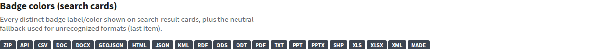
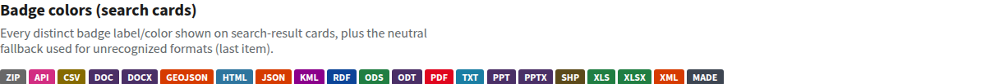

# Resource-format badge colors

Search, organization, and collection cards share the format badge palette in
`app/filters.py`. Known formats retain their existing colors; unknown and missing
formats use the neutral `#3d4551` fallback. Text labels remain visible so color is
not the only way to identify a format.

The generated stylesheet uses
`ul.dataset-resources li .label.badge-color-<hex>` selectors to outrank the neutral
SCSS fallback, regardless of stylesheet order. Colors remain in the existing
CSP-compatible style block; no inline style attributes or CSP changes are needed.

White badge text has a contrast ratio of at least 4.5:1 across the palette. Hover
and keyboard focus underline resource links while preserving their colors and
the USWDS focus outline. Do not apply a brightness filter to the entire badge:
it darkens the text along with the background and can reduce contrast below
the [WCAG small-text requirement](https://www.w3.org/WAI/WCAG22/Understanding/contrast-minimum.html).

## Visual regression

Before the fix, the more-specific neutral SCSS rule overrode every format color:

After the fix, the existing colors are restored:

These captures use the existing local `/style-guide/icons` page, which includes
every distinct label/color combination and the unknown-format fallback.

## Validation and release

Unit tests cover generated selectors and unrounded palette contrast ratios.
`tests/browser/test_resource_badges.py` runs in the blocking browser job, without
the advisory `accessibility` marker. It checks computed colors, hover, keyboard
focus, link destinations, stylesheet order, scoped axe contrast results, and
badges in initial and HTMX-loaded results in Chromium and Firefox.

Build assets before running browser tests, then run the unit and browser suites
using the repository's standard setup. Keep PostgreSQL/OpenSearch test fixtures
isolated from any running browser session when executing the unit suite.

This is a catalog-only application/asset change. No API change, database
migration, or OpenSearch reindex is required. After deployment to staging, check
badge colors, contrast, and keyboard navigation using the published assets before
promoting to production. Roll back by reverting the change and redeploying.

Related issue: [GSA/data.gov#6532](https://github.com/GSA/data.gov/issues/6532).
